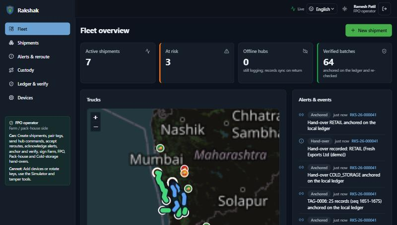
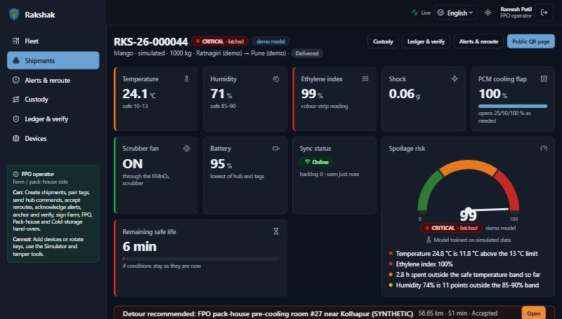
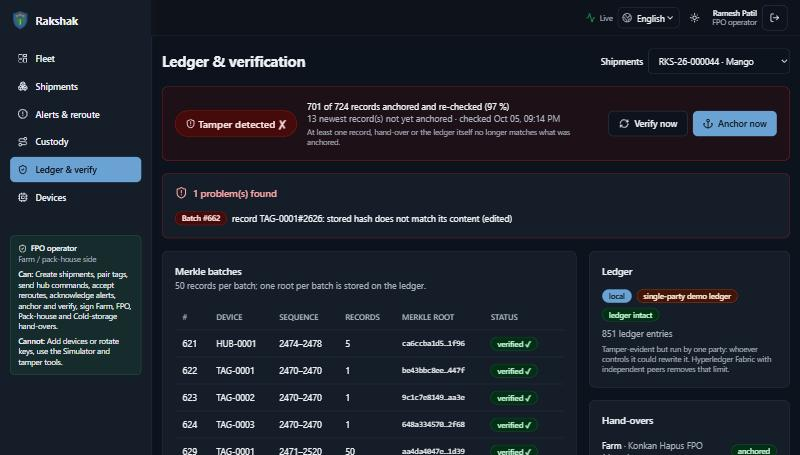
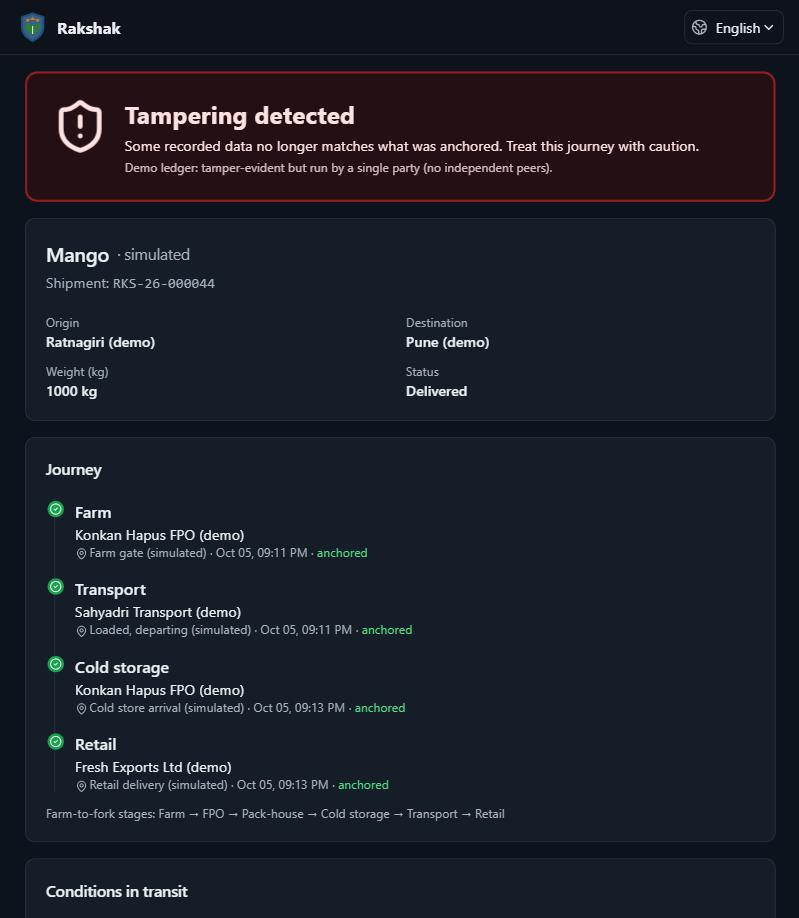
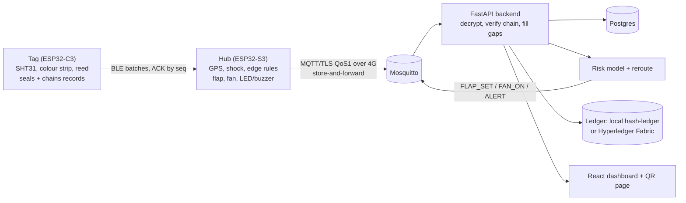

# Rakshak

**Low-cost IoT nodes with tamper-evident records for farm-to-fork traceability**

[](https://github.com/SaumyaTripathi-ctrl/RAKSHAK-/actions/workflows/ci.yml)
[](LICENSE)


Smart India Hackathon **SIH26232** · Ministry of Food Processing Industries · Hardware category

> **Sense → Predict → Preserve → Secure → Trace**

Rakshak watches perishable produce (fruit, vegetables, dairy) on its way from the farm to the buyer, in places where mobile
coverage comes and goes. Cheap crate **Tags** log temperature, humidity and ethylene (a colour strip read by a sensor). A
truck **Hub** adds GPS and shock, keeps logging with no network, and acts on its own: it opens a phase-change-material
(PCM) vent flap when the load warms and runs an ethylene scrubber fan. When 4G returns it uploads everything. Every record is
encrypted and hash-chained on the device, so later edits are detectable. The backend predicts spoilage, reroutes to the
nearest compatible cold store, and anchors a Merkle root of each batch on a ledger. Buyers scan a QR code to see the verified
journey.



## Highlights

| | |
|---|---|
| **Works offline** | Tags and hub log with no network, store encrypted records in flash, and sync oldest-first when connectivity returns (each record is deleted from the device only after it is acknowledged). |
| **Acts on its own** | Edge rules on the hub: adaptive PCM flap (0 / 25 / 50 / 100 %), ethylene scrubber fan from the ethylene trend, LED + latching buzzer. AI commands can raise the flap floor or force the fan, but never disable the edge rules. |
| **Tamper-evident** | AES-256-GCM per-device keys, SHA-256 hash chain, Merkle root per 50-record batch on a ledger. Edited, deleted or re-hashed records show up as **Tamper ✗** on the Verify page. |
| **Predicts and reroutes** | Spoilage risk and remaining safe life with plain-language reasons; when a load goes critical, it proposes the nearest compatible cold store by road time. |
| **Public provenance** | A no-login QR page shows the custody timeline, conditions in transit, offline gaps and the verification status. |
| **Roles** | Administrator, FPO operator, Driver and Exporter/buyer see and may do different things (see the role card in the sidebar). English and Hindi UI, dark theme by default. |

| Shipment view (critical, detour recommended) | Verify page (tamper detected) | Public QR page |
|---|---|---|
|  |  |  |

## Architecture



More detail: [`docs/ARCHITECTURE.md`](docs/ARCHITECTURE.md). The binary record format, crypto and cross-language test
vectors are specified in [`firmware/common/spec/RECORD_SPEC.md`](firmware/common/spec/RECORD_SPEC.md).

## Quick start

Requires [Docker Desktop](https://www.docker.com/products/docker-desktop/) (Windows: WSL2 backend) and Git.

```powershell
git clone https://github.com/SaumyaTripathi-ctrl/RAKSHAK-.git
cd RAKSHAK-
scripts\up.ps1            # Windows;  Linux/macOS: make up   (or: docker compose up --build)
```

Open **http://localhost:8080** and use a demo-account button (the sign-in button then logs in). The first start trains the
risk models during the image build (a few minutes), then the simulator backfills five finished trips and starts three live
trucks driving real roads.

Play the full scripted story (heat → flap opens → ethylene rises → fan on → network cut → logging continues → reconnect →
backlog syncs → critical → reroute → tamper → Verify says **Tamper ✗** → QR page):

```powershell
scripts\demo.ps1          # Linux/macOS: make demo
```

Walk-through: [`docs/DEMO.md`](docs/DEMO.md). Stop with `scripts\down.ps1` (add `-Volumes` to reset the data).

**Demo accounts (development only, shown on the login page only because the server runs with dev secrets):**
`admin`, `fpo`, `driver`, `exporter` with passwords `admin123`, `fpo123`, `driver123`, `exporter123`. Change every secret in
`.env` before any real deployment (`.env.example` lists them).

## Repository layout

| Path | What |
|---|---|
| `firmware/common/` | Portable C library (codec, flash ring, device identity, edge rules, BLE batching, command parsers) + the normative record spec + test vectors |
| `firmware/tag_esp32c3/`, `firmware/hub_esp32s3/` | PlatformIO projects (Arduino-ESP32 3.x) |
| `backend/` | FastAPI app: ingest, custody, ledger anchoring/verify, prediction API; `backend/rakshak/codec/` is the Python reference codec |
| `ml/` | Produce simulator, feature engine, training, evaluation, model card |
| `ledger/` | Ledger clients; optional Hyperledger Fabric chaincode (Go) and bridge (Node) |
| `simulator/` | Virtual hubs and tags that speak the real encrypted protocol over MQTT |
| `frontend/` | React + Vite + TypeScript dashboard (Tailwind, Leaflet, Recharts) |
| `infra/` | Mosquitto (TLS + per-hub ACL), Postgres init, dev-certificate script |
| `docs/` | Architecture, API, MQTT protocol, demo, decisions, limitations, provisioning |
| `tools/` | Test-vector generators and the scripted demo driver |

## Testing

```powershell
scripts\test.ps1          # Linux/macOS: make test
```

Runs the Python suite (backend, ML, simulator: 220 tests), the C host tests (codec vectors against the Python reference, flash
ring + device identity, edge rules, BLE batching, parsers), and the frontend checks (type-check, lint, 60 tests). Firmware
builds: `pio run -d firmware/tag_esp32c3` and `pio run -d firmware/hub_esp32s3`. The real-broker integration tests run when
Mosquitto is up on `localhost:8883` (stop the simulator first: `docker compose stop simulator`). CI runs all of it on every push.

## Honest status: what is real and what is not

This is a working prototype built for the hackathon. We label everything that is simulated, and the UI does too.

- **Simulated:** the ML training data (a produce simulator, so reported accuracy measures fit to the simulator, not to real
  spoilage), the cold-storage dataset (163 synthetic facilities), and the device traffic in the demo. See
  [`ml/artifacts/MODEL_CARD.md`](ml/artifacts/MODEL_CARD.md).
- **Not hardware-tested:** the firmware compiles and its portable core is tested on a PC against the Python reference, but it
  has not been run on boards. The A7670C modem commands, BLE behaviour and servo range are unverified.
- **Pending calibration:** the ethylene colour-strip table is a placeholder until it is calibrated against a reference sensor.
  Food temperature bands are marked TODO-verify.
- **Trust model:** ESP32 has no secure element, so a stolen device could leak its key. The ledger proves *no later alteration*,
  not that a sensor told the truth. The default ledger is single-party; the Hyperledger Fabric option is experimental.

Full list: [`docs/LIMITATIONS.md`](docs/LIMITATIONS.md). Why each design choice was made: [`docs/DECISIONS.md`](docs/DECISIONS.md).

## Documentation

[Architecture](docs/ARCHITECTURE.md) · [API reference](docs/API.md) · [MQTT protocol](docs/PROTOCOL.md) ·
[Record spec](firmware/common/spec/RECORD_SPEC.md) · [Demo script](docs/DEMO.md) ·
[Device provisioning](docs/PROVISIONING.md) · [Firmware notes](firmware/README.md) ·
[Decisions](docs/DECISIONS.md) · [Limitations](docs/LIMITATIONS.md)

## License

MIT, see [LICENSE](LICENSE). Evolved from our earlier MedRakshak prototype (SIH26215).
