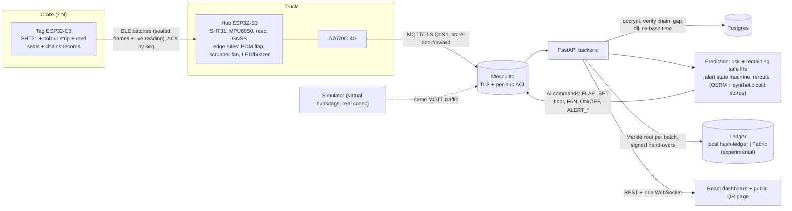

# Architecture

## Data path of one sample

1. Tag wakes (every minute), reads SHT31 (and the strip every 5th wake), builds a fixed-layout 50-byte body.
2. `rk_device_emit`: persist `seq` first, derive nothing new (key from NVS), encrypt with AES-256-GCM
   (nonce = 8 zero bytes || seq; AAD = 24-byte header), chain `hash = SHA-256(prev || body)`, persist chain head, push the
   154-byte frame into the flash ring.
3. Every 5th wake the tag advertises; the hub pulls the batch, stores the frames, ACKs by seq range (+ GNSS time); the tag
   deletes only after the ACK.
4. Hub drains its ring oldest-first over MQTT QoS 1 and removes each frame only after PUBACK.
5. Backend decrypts with the per-device HKDF key, checks the chain (`BAD_HASH`, `CHAIN_BREAK`, `MISSING`,
   `DUPLICATE`), stores, fills late gaps, re-bases `ts_valid=0` timestamps from `TIME_SYNC` events.
6. Batches of 50 contiguous records get a Merkle root anchored on the ledger; `/api/verify` recomputes everything from
   the stored ciphertext and reports `VERIFIED / PARTIAL / PENDING / TAMPERED / LEDGER_UNREACHABLE`.
7. Prediction service scores the shipment, runs the alert state machine and, if needed, sends commands or proposes a
   detour to the nearest compatible cold store.

Normative record format: `firmware/common/spec/RECORD_SPEC.md`. MQTT contract: `docs/PROTOCOL.md`.
Decisions and their reasons: `docs/DECISIONS.md`.

## Trust model (short)

Tags/hub hold symmetric keys (no secure element on ESP32): key extraction from a stolen device is possible.
The ledger protects against **later** tampering of stored data; it cannot prove a sensor told the truth. Hand-over
signatures are Ed25519 by the server on behalf of parties (demo). See `docs/LIMITATIONS.md`.
